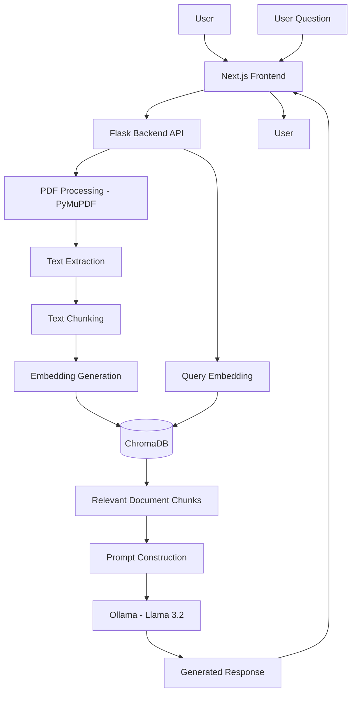

# MedRAG — AI-Powered Medical Knowledge Retrieval System (Just a Minimum Viable Protitype or Proof of Concept)

<p align="center">
  <strong>Transform medical documents into searchable knowledge using Retrieval-Augmented Generation (RAG).</strong>
</p>

<p align="center">
  
  
  
  
  
  
</p>

---

## 1. Overview

**MedRAG** is an AI-powered medical document question-answering application built using Retrieval-Augmented Generation (RAG).

It allows users to interact with medical documents and retrieve relevant information through natural-language queries rather than manually searching through lengthy PDF files.

The application combines document processing, semantic retrieval, vector embeddings and Large Language Models (LLMs) to generate context-aware responses from indexed documents.

The MVP uses a locally hosted LLM through Ollama, allowing users to experiment with document-based AI workflows without relying on a paid cloud LLM API.

### Key Features

- **PDF Document Processing:** Extract text from PDF documents using PyMuPDF.
- **Document Indexing:** Convert extracted text into searchable vector representations.
- **Semantic Search:** Retrieve relevant document content based on query meaning.
- **AI-Powered Question Answering:** Generate natural-language responses using an LLM.
- **Local LLM Integration:** Run models locally through Ollama.
- **Vector Storage:** Store and retrieve document embeddings using ChromaDB.
- **Web Interface:** Interact with the application through a Next.js frontend.

> **Project status:** This repository currently contains an experimental Minimum Viable Product (MVP). It is intended for learning, research and demonstration purposes, not clinical diagnosis or medical decision-making.

---

## 2. Application Preview

Add screenshots of your running application in the `docs/screenshots/` directory.

| Application Component | Preview |
|---|---|
| Dashboard |  |
| Document Upload |  |
| AI Chat Interface |  |

*Replace these images with actual application screenshots.*

---

## 3. System Architecture

MedRAG follows a Retrieval-Augmented Generation architecture.

Instead of sending an entire document directly to an LLM, the application processes the document, retrieves relevant information and uses that information as context for generating responses.

### Architecture Overview



### How RAG Works

**Step 1 — Document ingestion**

The user provides a medical PDF document through the application.

**Step 2 — Text extraction**

PyMuPDF extracts readable text from the PDF.

**Step 3 — Text chunking**

The extracted text is divided into smaller segments to make retrieval more efficient.

**Step 4 — Embedding generation**

Text segments are transformed into numerical vector representations.

**Step 5 — Vector storage**

The generated embeddings and associated document content are stored in ChromaDB.

**Step 6 — Semantic retrieval**

When a user submits a question, the system searches for relevant document segments.

**Step 7 — Context-aware generation**

The retrieved information is passed to the locally hosted LLM through Ollama.

**Step 8 — Response generation**

The LLM generates a natural-language response using the retrieved context.

---

## 4. Technology Stack

| Layer | Technology | Purpose |
|---|---|---|
| Frontend | Next.js | User interface |
| Backend | Python, Flask | Application API |
| Document Processing | PyMuPDF | PDF text extraction |
| LLM Runtime | Ollama | Local language model inference |
| Language Model | Llama 3.2 | Response generation |
| Vector Database | ChromaDB | Embedding storage and retrieval |
| AI Architecture | RAG | Context-aware question answering |

---

## 5. Prerequisites

Install the following software before setting up the project.

| Software | Requirement | Download |
|---|---|---|
| Python | 3.10 or compatible project version | [Python](https://www.python.org/downloads/) |
| Node.js | LTS version | [Node.js](https://nodejs.org/) |
| Git | Latest stable version | [Git](https://git-scm.com/downloads) |
| Ollama | Latest stable version | [Ollama](https://ollama.com/) |
| VS Code | Recommended IDE | [VS Code](https://code.visualstudio.com/) |

You will also need sufficient RAM and disk space to run the selected LLM locally.

---

## 6. Installation and Setup

Follow these instructions to run MedRAG on your local machine.

### Step 1 — Clone the repository

Open your terminal and execute:

```bash
git clone https://github.com/abinesh007/MedRAG.git
```

Navigate into the project:

```bash
cd MedRAG
```

### Step 2 — Set up the Python backend

Navigate to the backend directory:

```bash
cd backend
```

Create a Python virtual environment:

**Windows:**

```powershell
python -m venv med-rag-venv
```

Activate the environment:

```powershell
.\med-rag-venv\Scripts\activate
```

**Linux / macOS:**

```bash
python3 -m venv med-rag-venv
source med-rag-venv/bin/activate
```

Install the required Python packages:

```bash
pip install -r requirements.txt
```

If a requirements file is not yet available, install the project's actual dependencies individually before proceeding.

### Step 3 — Configure Ollama

Download and install Ollama:

https://ollama.com/download

Open a terminal and download the language model:

```bash
ollama pull llama3.2
```

Verify the installation:

```bash
ollama list
```

You should see `llama3.2` among your locally available models.

Test the model:

```bash
ollama run llama3.2
```

Try a simple question to verify that the model responds.

Exit the interactive session when finished.

**Important:** The backend must reference the same model name that you have downloaded.

### Step 4 — Start the Python backend

From the `backend` directory, activate the virtual environment if it is not already active.

Start the Flask application:

```bash
python app.py
```

If the application starts successfully, Flask should display a local server address, typically:

```text
http://127.0.0.1:5000
```

Keep this terminal running.

*If your backend entry point or port differs, use the configuration defined in your source code.*

### Step 5 — Set up the frontend

Open a second terminal.

Navigate to the frontend directory:

```bash
cd frontend
```

Install the Node.js dependencies:

```bash
npm install
```

If the frontend requires an environment file, create `.env.local` based on the frontend's existing configuration or `.env.example`.

For example, if your frontend uses an API base URL variable, configure it to point to your Flask backend.

Do not assume the environment variable name; check the existing frontend source code.

### Step 6 — Start the frontend

Execute:

```bash
npm run dev
```

The Next.js development server will typically be available at:

```text
http://localhost:3000
```

Open the address in your browser.

---

## 7. Running the Complete Application

Both servers must run simultaneously.

Open two terminals in VS Code.

| Terminal | Application | Command |
|---|---|---|
| Terminal 1 | Flask Backend | `python app.py` |
| Terminal 2 | Next.js Frontend | `npm run dev` |

The application architecture looks like this:

```text
             YOUR COMPUTER
                   |
          +--------+--------+
          |                 |
     FRONTEND            BACKEND
     Next.js              Flask
    Port 3000           Port 5000
          |                 |
          +--------+--------+
                   |
             AI PROCESSING
                   |
       +-----------+-----------+
       |           |           |
    PyMuPDF     ChromaDB     Ollama
                             Llama 3.2
```

Once both services are running, navigate to:

**http://localhost:3000**

---

## 8. How to Use MedRAG

### Step 1 — Launch the application

Open the frontend in your browser:

```text
http://localhost:3000
```

### Step 2 — Upload a medical document

Use the document upload functionality available in the application.

Select a supported PDF document from your local computer.

Examples of suitable documents include:

- Medical research papers.
- Biomedical literature.
- Medical textbooks.
- Clinical research documents.
- Healthcare-related reference material.

### Step 3 — Process the document

The backend extracts text from the uploaded PDF, prepares the text for retrieval and stores the corresponding vector representations in ChromaDB.

Wait for document processing to complete.

### Step 4 — Ask questions

Enter a natural-language question related to the uploaded document.

Example questions:

- What is the main objective of this research paper?
- Summarise the methodology used in this study.
- What are the major findings?
- Explain the limitations identified by the authors.
- What conclusions can be drawn from the document?

### Step 5 — Review the generated response

The LLM processes the retrieved document context and generates a response.

Verify the response against the original document before using the information.

*The exact upload workflow, indexing status and chat functionality depend on the implemented frontend and backend features.*

---

## 9. Project Structure

```text
MedRAG/
│
├── backend/
│   ├── app.py
│   ├── requirements.txt
│   ├── med-rag-venv/
│   └── ...
│
├── frontend/
│   ├── public/
│   ├── node_modules/
│   ├── package.json
│   └── ...
│
├── docs/
│   ├── architecture.md
│   └── screenshots/
│
├── .gitignore
├── LICENSE
└── README.md
```

*This is a simplified representation. Virtual environments and node_modules should be generated locally rather than committed to GitHub.*

---

## 10. Troubleshooting

### Issue 1 — Python module not found

**Error:**

```text
ModuleNotFoundError: No module named 'pymupdf'
```

**Solution:**

Activate the backend virtual environment and execute:

```bash
pip install pymupdf
```

If other modules are missing:

```bash
pip install -r requirements.txt
```

### Issue 2 — Flask server not starting

Check that:

- You are inside the backend directory.
- Your virtual environment is activated.
- Dependencies are installed.
- The backend entry-point file exists.
- The required port is available.

### Issue 3 — Ollama connection failure

Verify that Ollama is installed and running.

Check the downloaded models:

```bash
ollama list
```

Start the Ollama service if necessary, then verify that the backend uses the correct model name.

### Issue 4 — Frontend dependencies missing

Navigate to the frontend directory:

```bash
cd frontend
npm install
```

Then restart the development server:

```bash
npm run dev
```

### Issue 5 — Frontend cannot connect to backend

Verify that:

- Flask is running.
- The backend URL configured in the frontend is correct.
- The API endpoint exists.
- CORS is configured appropriately if the frontend and backend use different origins.

### Issue 6 — ChromaDB or indexing errors

Check the backend configuration and ensure that:

- The configured database directory is writable.
- The embedding model is available.
- Documents are processed successfully.
- The vector database is not being accessed by incompatible concurrent processes.

---

## 11. Privacy and Medical Disclaimer

MedRAG is an experimental AI application intended for educational, research and software-development purposes.

- The application is not a substitute for professional medical advice.
- AI-generated responses may contain inaccuracies or hallucinations.
- Always verify generated information against the original source documents.
- Do not upload identifiable patient records or confidential medical information without appropriate authorisation and security safeguards.
- Local LLM inference does not automatically guarantee complete data privacy; review the application's storage, logging and network configuration.
- The current MVP has not been validated for clinical deployment.

---

## 12. Future Development

Potential directions for future development include:

- [ ] Advanced document ingestion and OCR.
- [ ] Hybrid search combining semantic and keyword retrieval.
- [ ] Improved biomedical embedding models.
- [ ] Source-level and page-level citations.
- [ ] Multi-document question answering.
- [ ] Conversation memory and history.
- [ ] User authentication and document management.
- [ ] RAG evaluation and hallucination assessment.
- [ ] Retrieval quality benchmarking.
- [ ] Docker-based deployment.
- [ ] PostgreSQL integration.
- [ ] Production-grade monitoring and observability.

---

## 13. Contributing

Contributions, suggestions and improvements are welcome.

1. Fork the repository.
2. Create a feature branch.
3. Implement your changes.
4. Test your implementation.
5. Submit a pull request with a description of your changes.

---

## 14. Author

**Abinesh R L**

AI Engineer | Biomedical Engineering | Medical AI & RAG Systems

- GitHub: [@abinesh007](https://github.com/abinesh007)
- Portfolio: [Portfolio Website](https://abinesh007.github.io)

---

## 15. License

This project is distributed under the MIT License.

See the [LICENSE](LICENSE) file for more information.

---

<p align="center">
  <strong>MedRAG — Bridging Medical Knowledge and Artificial Intelligence.</strong>
</p>

<p align="center">
  Built for exploration, experimentation and advancing AI-powered biomedical knowledge retrieval.
</p>
